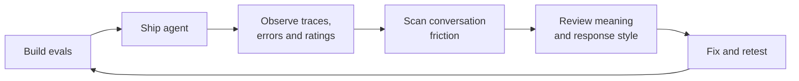
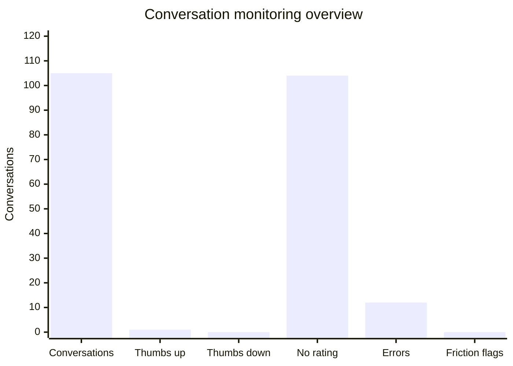

# Agent Friction Monitoring

A parameterized Databricks notebook that adds conversation friction to the AgentOps loop: **notice corrections, unproductive back-and-forth, missed requirements and tone mismatches, even when nobody leaves a thumbs-down**.

The [notebook](notebooks/genie_conversation_friction.ipynb) runs directly in Databricks: **widgets → Genie conversations → OpenJev → friction charts → review links**. Supply a Genie agent name; it reads conversation history and calls `system.ai.openjev-qwen35-4b` through Unity Gateway's System One API.

## The idea

Conversation friction is a sign that the exchange is harder than it needs to be. It can come from arguing or pushback, correcting an answer, repeating a missed requirement, steering the agent back to the task, or a tone or style that does not fit the user's needs. Even a factually correct answer can create friction if it feels condescending, dismissive, overly formal, too casual or unnecessarily verbose.

| Signal | What it can look like |
| --- | --- |
| Correction / challenge | “That is the order count. Count each customer once.” |
| Repeated requirement | “I already asked for September only.” |
| Redirection | “Go back to the customer question, please.” |
| Arguing / pushback | “Please stop debating my request and help me do it.” |
| Tone mismatch | “The number is fine. Please don't be condescending.” |

An ordinary clarification, drill-down or new question is not friction. The notebook measures evidence against these five definitions, rather than using conversation length or the number of follow-ups as a quality signal.

For example, an analyst asks:

> **Analyst:** How many customers ordered in September? 
> **Genie:** 12,480. 
> **Analyst:** Hang on, that is our order count. Can you count each customer once?

On review, the SQL counted order rows. Changing it to `COUNT(DISTINCT customer_id)` gives **8,760 customers** in this example. The follow-up supplied a review signal even though the query succeeded and the analyst left no rating.

For a counting mistake, confirm the definition and add the question with expected SQL to the Genie benchmark. For arguing or tone mismatch, add response-behavior expectations to the relevant evals. Clarify the agent's instructions and retest.

## Conversation monitoring overview

The measured trace sample contains **105 conversations** created between February 9 and July 20, 2026. The notebook's overview chart counts conversations with each signal:

| Signal | Conversations |
| --- | ---: |
| Total conversations | 105 |
| Thumbs up | 1 |
| Thumbs down | 0 |
| No rating | 104 |
| Logged errors | 12 |
| Conversation friction flags | 0 |

All **105 conversations were scored** in a Databricks serverless run, with no read failures or unscored conversations. None of the five friction signals reached the **0.70 threshold**. Categories overlap: a conversation can have a rating, an error and a friction flag. These counts describe the observed history; they do not establish a production-only cohort.

The notebook renders the overview and a breakdown of the five friction categories directly in cell outputs. Running it against another agent or time window replaces these counts with that agent's results.

## Run the notebook

Import the notebook into the same Databricks workspace as your Genie space and attach serverless compute or a recent Databricks Runtime. Run the parameters cell to create the widgets; it stops until the required agent name is entered. Fill in the widgets and select **Run all**. Leave the optional space ID empty for a uniquely named agent; provide an ID to distinguish duplicate names. Section 1 of the notebook includes the full setup guide.

For example, enter `Sales Analytics` as `genie_agent_name` and keep the defaults to evaluate up to 10 of your conversations created in the last 30 days. For a larger view, use `lookback_days=90` and `max_conversations=25`. Replace the example name and optional ID with your own. The space ID is the segment after `/genie/rooms/` in the Genie URL.

| Parameter | Default | Purpose | Example value |
| --- | --- | --- | --- |
| `genie_agent_name` | empty; required | Exact displayed name of your Genie space | `Sales Analytics` |
| `genie_space_id` | empty | Optional ID for duplicate names; must match the name | `0123456789abcdef0123456789abcdef` |
| `model` | `system.ai.openjev-qwen35-4b` | System One model service | `system.ai.openjev-qwen35-4b` |
| `lookback_days` | `30` | Conversation creation window in days | `90` |
| `max_conversations` | `10` | Maximum conversations to read, newest first | `25` |
| `signal_threshold` | `0.70` | Flag a conversation when any friction signal reaches this value | `0.70` |
| `include_all` | `false` | `false` reads your conversations; `true` reads across users and requires CAN MANAGE | `false` |

The notebook uses the SDK, pandas and Matplotlib bundled with Databricks. The current identity needs Genie access and permission to execute the model service. `WorkspaceClient()` uses notebook authentication. Parameters, charts and the review table stay in Databricks; there is no local environment setup or file-export configuration.

Set the agent parameters to generate charts from its traces. The notebook starts with cleared outputs.

## Reading live results

Five `noul` questions score **correction**, **repeated requirement**, **redirection**, **arguing / pushback** and **tone mismatch**. Each conversation is evaluated once using its ordered dialogue. Ratings and errors are kept out of the model input so friction is an independent signal.

A conversation is flagged when any signal reaches the threshold. Incomplete conversations and failed evaluations remain unscored and are listed separately. The charts show scoring coverage, and signal categories overlap. Scores are uncalibrated and can vary between runs; a flag suggests review and does not establish a SQL error.

The review table lists friction types, scores and links to the original Genie conversations, where the generated SQL can be inspected. It also counts flagged conversations with no logged error or thumbs-down. The lookback uses conversation creation time, so older threads with recent activity need a longer window.

Open a flagged conversation → identify the cause of friction → review the SQL, metric definition or response style → turn confirmed misses into suitable evals → clarify instructions and retest.

## References

- [Databricks System One API](https://learn.microsoft.com/en-us/azure/databricks/machine-learning/model-serving/query-systemone-models)
- [Genie conversation API](https://docs.databricks.com/api/genie/v1/conversation) and [benchmarks](https://docs.databricks.com/aws/en/genie-agents/monitor#benchmarks)
- Related ideas: [LangSmith Perceived Error](https://www.langchain.com/blog/introducing-langsmith-tuned-evaluators-starting-with-perceived-error) and [MLflow UserFrustration](https://mlflow.org/docs/latest/genai/eval-monitor/running-evaluation/multi-turn/). This notebook uses its own friction rubric.
